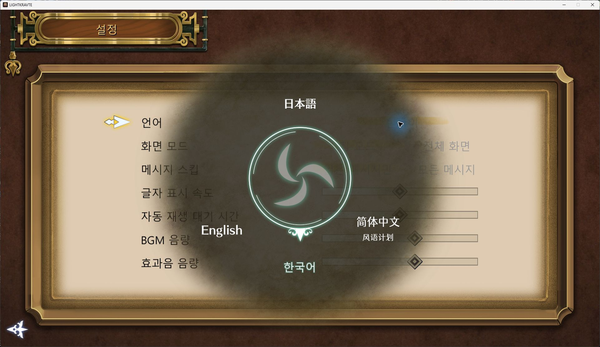

# Fault StP LIGHTKRAVTE 한국어 패치

> 비공개 보관·유지보수용 저장소

`Fault StP LIGHTKRAVTE`의 일본어 원문을 기준으로 제작한 한국어 패치입니다.
원본에 숨겨져 있던 `zh-TW` 선택 슬롯을 `한국어`로 재사용하며, 일본어·영어·간체
중국어는 그대로 보존합니다.



## 추가·변경 사항

원판(Fault StP LIGHTKRAVTE PC판, 공식 한국어 없음) 대비 이 패치가 더하거나 바꾼 것을 정리했다.
괄호 안은 근거가 된 커밋·파일이다. 확실하지 않은 것은 「(추정)」으로 표시했다.

> **재번역 작업물과의 관계**: 이 저장소는 **출시된 패치(v1.0.0·v1.0.1)의 보관본**이다.
> 그 뒤 2026-08-29~09-08에 한 제미나이 재번역, 기존 번역 후속 교정(16행+5행, 「클록스」 표기 통일),
> 그림·오프닝 크레딧 한국어화 검수는 별도 저장소 `fault-stp-lightkravte-retranslation-wip`에 있고,
> **게임 폴더와 이 저장소의 배포본에는 아직 반영되지 않았다.** 품질 비교 결과 재번역본을 통째로 쓰지 않고
> 이 저장소의 기존(Codex) 번역을 기반으로 유지하기로 했으므로, 다음 판(v1.0.2 등)이 나온다면 이 번역에
> 그 교정만 더한 것이 된다 (재번역 저장소의 `quality-comparison-2026-08-30/QUALITY_COMPARISON_KO.md`,
> `asset-review-2026-09-04/production_2026-09-08/REVIEW_KO.md`).

### 번역 범위

- **번역 원문**: 일본어 원문(`ja`)이 의미의 기준이다. 영어·간체 중국어는 표기와 모호성 확인에만 참고했다. 번역은 Codex 내부 모델로 했다 (`package/reports/language_contract.json`, `package/reports/glossary.md`, `PATCH_INFO.json`).
- **본문**: 스크립트 48개의 대사·내레이션(`PrintText`) 6,746개 전부. 화자가 있는 대사 5,457개, 화자 ID 34종을 모두 한국어 이름으로 표시한다 (`package/reports/runtime_technical_report.md`).
- **관리 텍스트 425개**: UI 85개, 인물명 58개, 사용자 UI 1개, 로케일명 233개, Tips 48개 (`package/README_KO.md`, `translations/managed/*.jsonl`).
- **화자명**: 대사창·백로그·채팅 표시·이름 식에 같은 한국어 이름이 나오게 했다. 원문 데이터에 역할명이 일본어로 직접 들어 있던 `ch03-04:1145`의 「医療班」도 「의료반」으로 연결했다.
- **루비(독음)**: 처음(v1.0.0)에는 루비 40개의 읽기를 모두 한국어로 옮겼지만, v1.0.1에서 용도별로 다시 나눴다. 읽는 법만 알려 주는 루비 16개는 태그를 떼고 본문만 남기고, 본문과 뜻이 다른 루비는 두 층을 모두 옮기고, 강조점 `<ruby="・">`는 그대로 둔다. 루비 스팬은 46개에서 30개가 되었다. `ch01-11:206`, `ch03-02:91`은 원문의 두 층을 되살렸고, `ch02-12:880`은 다음 줄의 말장난이 살도록 고쳤다 (`56f6b43`, `package/reports/ruby_localization.json`).
- **용어**: 인물·지명·기관명 고정 표기를 용어집으로 관리한다(예: カージ=카지, フローラ=플로라). 작품의 로마자 브랜드 `CLOQKS`는 처음 나올 때 한국어 독음을 함께 적었다 (`package/reports/glossary.md`, `terminology.json`, `quality_manual_review_v2.md`).
- **기존 언어 보존**: 일본어·영어·간체 중국어 데이터는 고치지 않았다. 한국어 모드는 내부적으로 일본어 리소스를 그대로 돌리고 화면에 보이는 글만 바꾼다.
- **미번역**: 시작 화면의 기록문·면책문 그림, 크레딧 그림, 오프닝 영상의 영문 역할명 등 그림·영상 속 글자는 이 판에서 바꾸지 않았다. 이 작업은 재번역 저장소에서 검수 중이다 (재번역 저장소 `asset-review-2026-09-04/UNTRANSLATED_ASSET_INVENTORY_KO.md`).

### 편의 기능·조작

- **언어 선택기의 「한국어」 버튼**: 원판 설정 화면에 숨겨져 있던(`m_IsActive=false`) 번체 중국어(`zh-TW`) 버튼을 살려 「한국어」로 쓴다. 이 버튼은 간체 중국어 버튼과 같은 자리에 겹쳐 있었으므로 아래 가운데 빈자리로 옮겼고, 고르면 언어 바퀴의 바늘이 아래(180°)를 가리키게 했다. 키보드·패드 이동은 한국어 위=일본어, 왼쪽=영어, 오른쪽=간체 중국어로 이어진다. 디스크의 에셋은 바꾸지 않고 불러온 화면만 고친다 (`src/LightKravteKorean.cs`, `runtime_technical_report.md`의 「언어 선택기」).
- 한국어를 고른 상태는 설정에 기억된다(`KoreanActive`). 일본어·영어·간체 중국어를 고르면 한국어 모드가 꺼지고 원래 언어가 그대로 나온다.
- 게임 자체의 단축키나 조작은 바꾸지 않았다.

### 화면·글꼴

- **한글 글꼴**: 게임에 든 글꼴에는 한글이 없다. 플러그인은 `fonts\Korean.ttf`가 있으면 그것을, 없으면 Windows에 설치된 맑은 고딕 → Noto Sans CJK KR → Noto Sans KR → 나눔고딕 순으로 찾아 대체 글꼴로 붙인다. 글꼴 파일은 배포본에 넣지 않았다. 번역에 쓰는 글자 1,176자(한글 1,075자)가 모두 표시되는지 확인했다 (`package/README_KO.md`, `font_coverage.json`).
- TextMeshPro에는 실제 글꼴 파일을 읽은 동적 글꼴을, uGUI에는 OS 동적 글꼴을 따로 써서 두 경로가 섞이지 않게 했다.
- **긴 대사 자동 축소**: 한국어 대사가 원래 대사창 밖으로 넘치면 필요한 만큼만 글자를 줄인다. 최소 크기는 원래의 75%다(`FitLongDialogue`, `MinFontScale`) (`56f6b43`, 설정 파일 `[Layout]`).
- **한글 아틀라스**: v1.0.1에서 한글 글꼴 아틀라스를 4096×4096 한 장(샘플 72, 여백 8, SDFAA, 동적)으로 만들고, 번역에 필요한 한글을 시작할 때 미리 채운다 (`56f6b43`).

### 버그 수정

- **v1.0.1 — 대사창 글자가 가끔 `□□□□`로 나오던 문제 보강**: 실시간 대사 표시(`RevealableTMProText`)가 따로 들고 있던 글꼴 머티리얼 캐시를, 대사를 넣을 때·로케일 글꼴이 바뀔 때·그리기 직전(PreRender)에 확인하고 비운다. 백로그에서는 멀쩡한데 대사창에서만 깨지던 증상에 맞춘 수정이다. 게임 안에서 끝까지 확인한 것은 아니다 (`56f6b43`, `runtime_technical_report.md`).
- **v1.0.0 개발 중 고친 것**: 기존 Doorstop 4.x와 BepInEx 5.4.21의 진입점이 맞지 않아 플러그인이 시작되지 않던 문제를, 공식 BepInEx 5.4.23.5 x64 한 벌로 통일해 고쳤다. OS 글꼴로 만든 TMP 글꼴이 실패하던 문제, 엔진 초기화 순서 때문에 관리 텍스트가 갱신되지 않던 문제도 고쳤다 (`runtime_technical_report.md`의 「로더 호환성 수정」, 「검증 산출물」).
- **번역 교정**: v1.0.0까지 장(ch01~ch03) 단위 교차 검수로 208행을 고쳤다(ch01 2,457행 중 153행, ch02 2,522행 중 30행, ch03 1,767행 중 25행). v1.0.1에서 품질 후보 46개를 다시 읽어 5행을 더 고쳤다: 일기 머리말의 마침표 3행(「모월 모일」, 「엄마에게」), 놀람의 え를 「어」로(`ch02-19:164`), 「!?」 부호 순서 통일(`ch02-14:307`) (`package/reports/crossreview_ch0*.md`, `quality_manual_review_v2.md`).

### 렌더 진단 기능 (v1.0.1)

설정 파일 `[Diagnostics]`의 `LogTextRendering = true`를 켜면 화면에 보이는 한글 글자의 글꼴·대체 글꼴 연결·아틀라스 장 수·머티리얼 캐시 일치 여부를 `BepInEx\LogOutput.log`에 적는다. 글리프 누락과 캐시 불일치를 따로 경고한다 (`56f6b43`).

### 설치·제거 방식

- BepInEx 5.4.23.5 x64(Doorstop 4.5.0) 로더와 Harmony 플러그인 `LightKravteKorean.dll`을 쓴다. 게임 원본 파일은 고치지 않는다 (`THIRD_PARTY_NOTICES.md`, `package/reports/loader_vendor_manifest.json`).
- 설치기 `Install-KoreanPatch.ps1`(내부적으로 `Patch-Korean.ps1 -Action Install`)는 쓰기 전에 다음을 확인한다: 패키지 152개 파일 체크섬, 게임 핵심 파일 11개(실행 파일, 에셋, 카탈로그, 번들, 어셈블리 3개, 원래 로더 파일 3개)의 길이와 SHA-256, 게임 실행 여부, 덮어쓰기 충돌.
- 원본 백업과 설치 기록(저널)은 게임·패키지 폴더 밖의 `%LOCALAPPDATA%\CodexGamePatches\FaultStPLIGHTKRAVTE`에 둔다. 파일은 옆에 임시 파일을 만든 뒤 바꿔 넣고, 중단되면 복구한다.
- 복원기 `Restore-KoreanPatch.ps1`은 패치가 더한 파일을 설치 해시와 같을 때만 지우고, 기존 로더 파일 3개를 백업 해시 확인 뒤 되돌린다. 사용자가 설치 뒤 고친 파일은 건드리지 않는다. v1.0.1부터는 설정 파일이 「한국어 켬/끔」 두 상태만 달라졌을 때 사용자 설정을 지킨다.
- 플러그인은 게임 어셈블리 3개의 해시가 맞지 않으면 후킹을 모두 끈다(`StrictBuildCheck`).
- `Patch-Korean.ps1 -Action Verify`로 설치된 파일을 패키지 목록과 대조할 수 있다 (`package/Patch-Korean.ps1`).
- 지원 판본: 위 11개 파일 해시가 맞는 Unity 2020.3.7f1 / Mono / Windows x64 빌드 한 가지다. 어느 상점판(스팀 등)인지는 기록에 없다 (`package/package_manifest.json`의 `trusted_originals`) (추정: 스팀판).

### 판(버전)별 변경 기록

| 판 | 날짜 | 내용 |
|---|---|---|
| v1.0.0 | 2026-07-26 | 첫 출시. 대사 6,746개·관리 텍스트 425개 번역, 루비 독음 40개, 교차 검수 교정 208건, 한국어 언어 버튼, 한글 대체 글꼴, 설치·복원기 (`61b3a1f`) |
| v1.0.1 | 2026-07-28 | 대사창 `□□□□` 보강(머티리얼 캐시), 4096 아틀라스, 긴 대사 자동 축소, 렌더 진단, 루비 재분류(46→30), 품질 재검토 5행 교정, 언어 설정이 바뀐 경우 사용자 설정을 지키는 복원 (`56f6b43`) |
| — | 2026-08-03 | 제3자 자산 권리 고지 `ASSET_NOTICE.md` 추가 (`7f1f448`) |
| (미출시) | 2026-08-29~09-08 | 제미나이 재번역·후속 교정·그림 검수. 이 저장소에는 반영 안 됨 → `fault-stp-lightkravte-retranslation-wip` |

### v1.0.1 검증 요약

- 노출된 일본어 0, 화자명 34/34, 루비 30/30 및 의도적 제거 16개, 글리프 누락 0, 치명 결함 0.
- 설치·복원·중단 복구·변조 거부·설정 보존 fixture 전부 통과, 실제 게임 폴더 설치와 152개 파일 정적 Verify 통과.
- v1.0.1은 사용자 요청에 따라 게임을 직접 실행하지 않고 빌드·정적 검사·fixture·설치 Verify까지만 했다.

### 알려진 문제

- v1.0.1의 `□□□□` 수정, 가장 긴 대사의 화면 맞춤(긴 세그먼트 19건), 되살린 루비는 실제 플레이 화면에서 끝까지 확인하지 않았다 (`runtime_technical_report.md`, `quality_manual_review_v2.md`).
- 지원 한글 글꼴(맑은 고딕 등)이 PC에 하나도 없으면 한국어가 제대로 나오지 않는다.
- 그림·영상 속 글자(시작 기록문·면책문, 크레딧, 오프닝 역할명)는 원문 그대로다.
- 확인된 교정 21행과 「클록스」 표기 통일은 재번역 저장소에만 있고 이 배포본에는 없다.
- 설치 스크립트의 기본 게임 경로가 작업 PC 기준이라, 다른 PC에서는 `-GameRoot`로 게임 폴더를 지정해야 한다 (`package/Install-KoreanPatch.ps1`).
- 지원하지 않는 게임 빌드(업데이트된 판 등)에서는 설치·복원이 시작 전에 멈춘다.

## 설치

1. 게임을 완전히 종료합니다.
2. `dist/FaultStP_LIGHTKRAVTE_Korean_v1.0.1.zip`을 게임 폴더 밖에 풉니다.
3. 압축을 푼 폴더에서 다음을 실행합니다.

```powershell
powershell -ExecutionPolicy Bypass -File .\Install-KoreanPatch.ps1
```

게임 경로가 기본값과 다르면:

```powershell
powershell -ExecutionPolicy Bypass -File .\Install-KoreanPatch.ps1 `
  -GameRoot '<게임 폴더 경로>'
```

## 검증

```powershell
powershell -ExecutionPolicy Bypass -File .\Patch-Korean.ps1 `
  -Action Verify -GameRoot '<게임 폴더 경로>' -Json
```

## 자동 렌더 진단

`BepInEx\config\` 안의 이 패치 설정 파일(`.cfg`)에서 다음 값을 켜면
`BepInEx\LogOutput.log`에 텍스트·폰트·머티리얼 캐시 상태가 자동 기록됩니다.

```ini
[Diagnostics]
LogTextRendering = true
```

## 복원

게임을 종료한 뒤 설치에 사용한 폴더에서 실행합니다.

```powershell
powershell -ExecutionPolicy Bypass -File .\Restore-KoreanPatch.ps1
```

원본 백업은 게임 및 패키지 폴더 밖의
`%LOCALAPPDATA%\CodexGamePatches\FaultStPLIGHTKRAVTE`에 저장됩니다. 설정 파일에서
허용된 네 값만 변경된 경우 복원 시 사용자 설정을 보존합니다.

## 무결성

v1.0.1 배포 ZIP:

```text
SHA-256 56588A685467408DACF1E0B9BED79AB54AA5CB50DF05F28B240BC28519C6A800
Size    1,267,771 bytes
```

`package/`는 최종 배포 ZIP의 루트와 바이트 단위로 동일한 사본입니다. 설치기는
패키지 전체 체크섬, 지원 게임 빌드, 실행 중인 프로세스와 덮어쓰기 충돌을 쓰기
전에 검사합니다. 런타임 변경을 허용하는 것은 스키마 검증된 비실행 설정 파일 한
개뿐이며, 나머지 payload는 정확한 해시가 필요합니다.

## 저장소 구성

- `dist/`: v1.0.0·v1.0.1 배포 ZIP과 SHA-256
- `package/`: 현재 v1.0.1의 무결성 검증 가능한 압축 해제 패키지
- `src/`: BepInEx/Harmony 런타임 플러그인 소스 스냅샷
- `docs/images/`: 실제 게임 GUI 검증 화면

게임 실행 파일과 원본 게임 에셋은 포함하지 않습니다.
